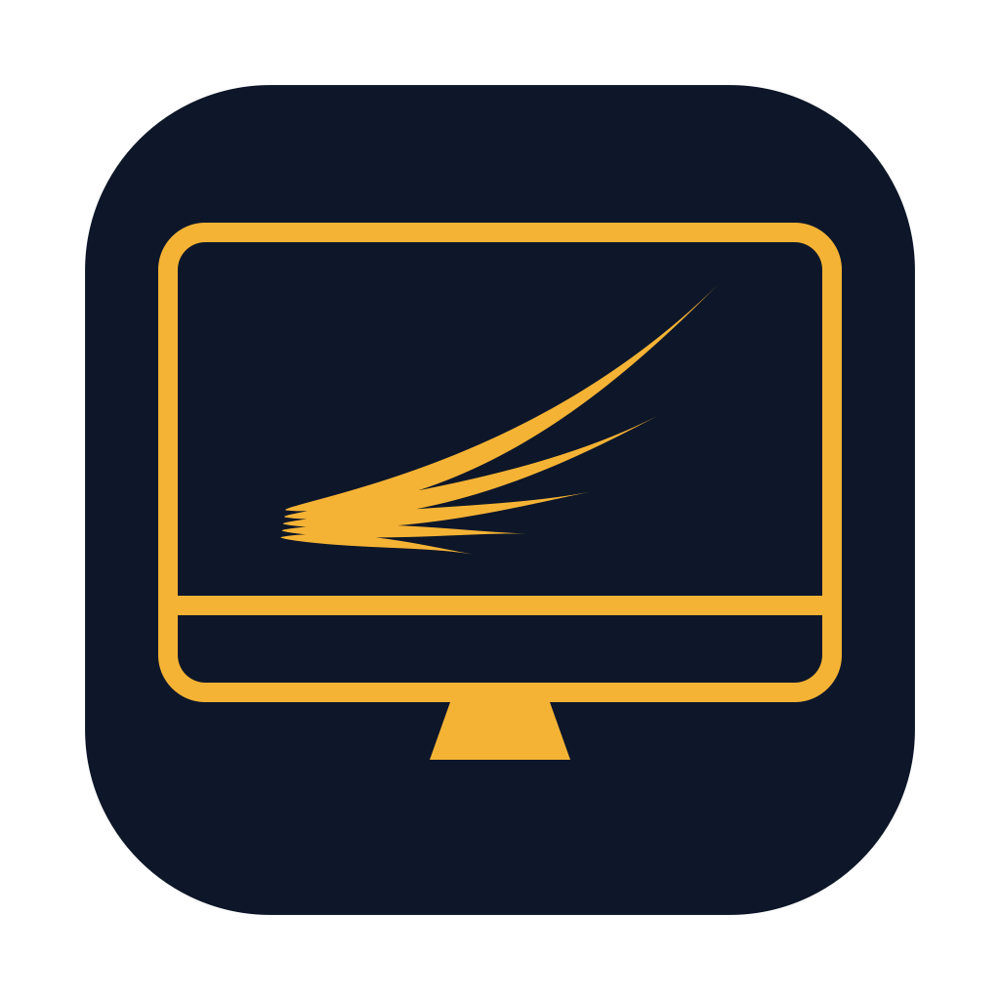

  

<h1 align="center">PWE Screen Encore</h1>

  <b>让 5K iMac 返场。</b> 
  用于 iMac：把 2014–2017 年的 5K iMac 变成新 Mac 的外接显示器。不刷机，不拆机，一根雷雳线。 
  1.1 起改名，原名 PWE iMac Display。 
  <a href="../docs/pwe/README.en.md">English</a>

---

> **下载最新版本**：[下载 DMG](https://github.com/kenshinice-ai/pwe-imac-display/releases/latest)，或 `brew install --cask kenshinice-ai/tap/pwe-imac-display`。
> 安装和连接步骤见 [安装指南](../docs/pwe/安装指南.md)。截至 2026-10-16 还没在真实的 Intel iMac 上运行过，遇到问题请开 issue。

## 这是什么

Apple 从 2014 年的 5K iMac 开始取消了「目标显示器模式」，Apple 芯片的 Mac 也完全用不了它。
那几年的 iMac 屏幕依然很好，却只能闲置。

PWE Screen Encore 用软件把这条路接回来：

- 新 Mac 上的 **PWE Screen Encore** 建一块虚拟显示器，把画面编码后经雷雳网桥发出去。
- iMac 上的 **PWE Screen Encore Receiver** 解码并全屏显示，iMac 就成了新 Mac 的一块屏。

## 和 TargetBridge 的关系

PWE Screen Encore 是开源项目 [TargetBridge](https://github.com/swellweb/targetBridge) 的一个构建版本，
作者是 Marco Caciotti（swellweb）和 TargetBridge 社区。核心代码来自 TargetBridge，按 MIT 许可使用。

PWE 在它之上做了这些：

| | PWE Screen Encore |
|---|---|
| 签名 | Apple Developer ID 签名并经 Apple 公证，双击即可打开，不用在终端里跑 `xattr` |
| 老 iMac | 接收端自己编译 FFmpeg 和 SDL2，目标系统 macOS 11，修正上游 [#167](https://github.com/swellweb/targetBridge/issues/167) |
| 许可 | 接收端用只解码的 LGPL 版 FFmpeg，不含 GPL 组件 |
| 中文 | 中文界面按 macOS 的系统用词重新校对；发送端默认跟随系统语言 |
| 互通 | 传输协议和 Bonjour 服务与 TargetBridge 相同，两边的 App 可以混用 |

修复和改进先提交给 TargetBridge 上游，例如 [中文重译 #212](https://github.com/swellweb/targetBridge/pull/212)。

## 需要什么

- 一台 Apple 芯片或 Intel 的 Mac，macOS 14 或更新，装发送端。
- 一台 5K iMac，装接收端。接收端以 macOS 11 为目标。
- 一根雷雳线。2014、2015 款 iMac 是雷雳 2 接口，需要 Apple 的雷雳 3（USB-C）转雷雳 2 转换器。

线材和转接头的细节见 [docs/Hardware.md](../docs/Hardware.md)（TargetBridge 的硬件说明）。

## 仓库怎么组织

这个仓库是 TargetBridge 的 fork。上游的代码原样保留，PWE 的部分都在这几处：

| 路径 | 内容 |
|---|---|
| `pwe/rebrand.py` | 打包时把源码副本改成 PWE Screen Encore：名字、标识、图标、致谢 |
| `pwe/receiver-deps.sh` | 编译接收端用的 FFmpeg 和 SDL2 |
| `pwe/package.sh` | 构建、签名、公证，打出一个装着两个 App 的 DMG |
| `pwe/icon/` | 图标生成程序 |
| `HANDOFF.md`、`docs/pwe/` | 交接和研究记录 |

## 许可

- TargetBridge：MIT，见 [LICENSE](../LICENSE)。
- FFmpeg：LGPL 2.1 或更新；SDL2：zlib。详见 [pwe/NOTICE.txt](../pwe/NOTICE.txt)。
- PWE 的名字和图标不在开源许可范围内。

## 支持

- 问题和建议：[Issues](https://github.com/kenshinice-ai/pwe-imac-display/issues)
- 所有 PWE 免费工具：[pwestudio.site/support](https://pwestudio.site/support)
